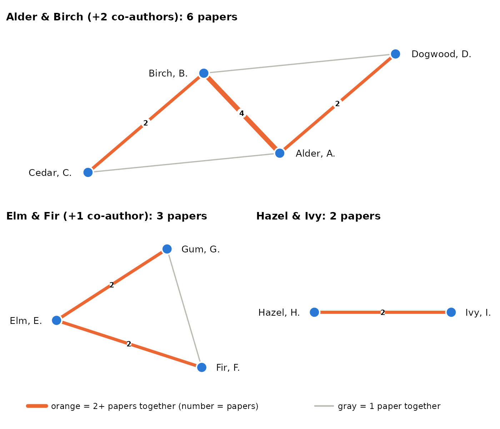
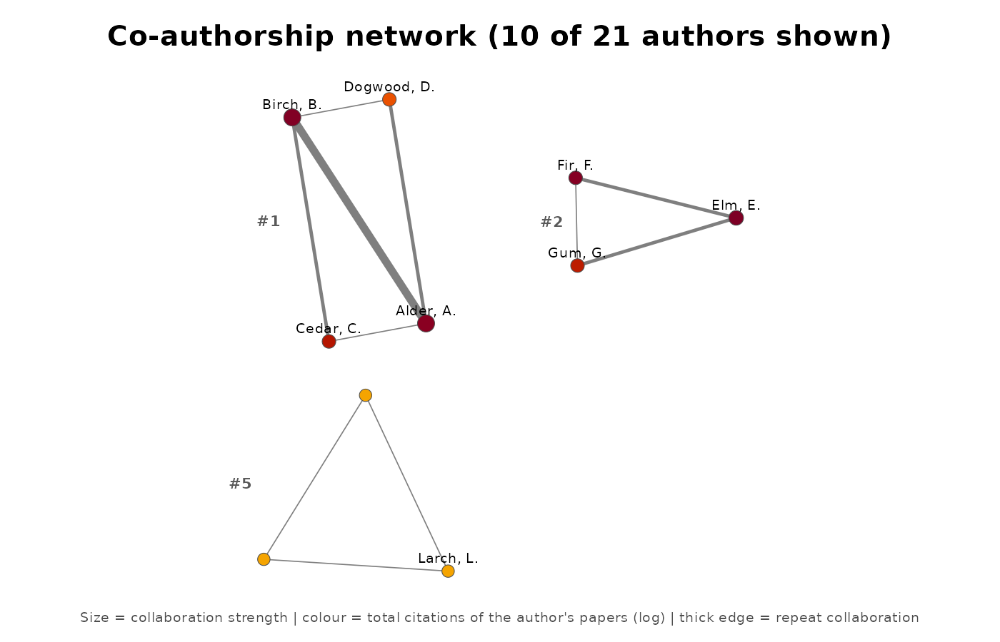
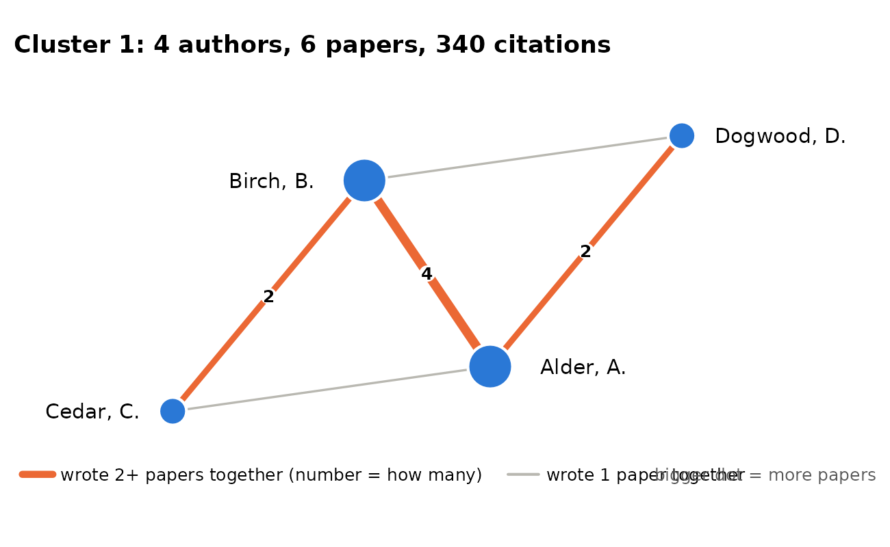
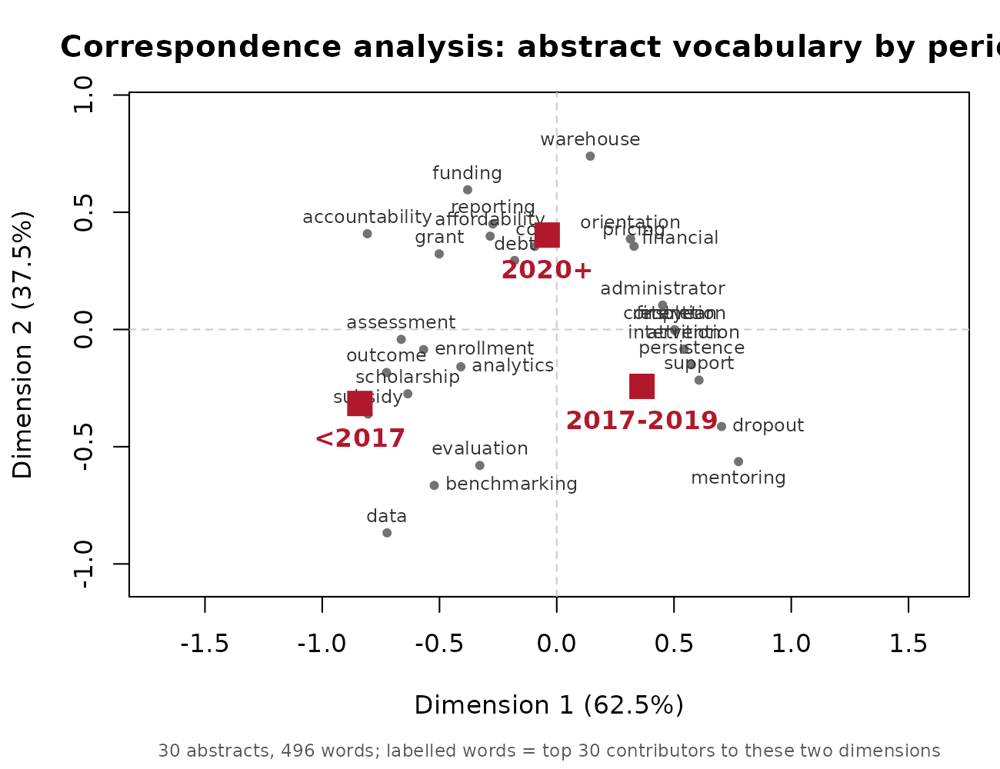

# Duplicates, rankings, networks and abstract analysis

## Introduction

The [Getting
started](https://cownr10r.github.io/citelens/articles/citelens.md)
vignette covers getting records into R: converting RefWorks and RIS
exports, reading BibTeX, parsing Google Scholar results, and filling in
missing abstracts. This vignette covers what you can do once you have a
data frame of papers. Four tools are described here:

| Question | Function |
|----|----|
| Is the same paper listed twice? | [`find_duplicate_papers()`](https://cownr10r.github.io/citelens/reference/find_duplicate_papers.md), [`dedupe_papers()`](https://cownr10r.github.io/citelens/reference/dedupe_papers.md) |
| Which papers, venues and authors are cited most? | [`citation_rank()`](https://cownr10r.github.io/citelens/reference/citation_rank.md) |
| Who writes together, and in which groups? | [`author_network()`](https://cownr10r.github.io/citelens/reference/author_network.md) and its plots |
| How does the vocabulary of abstracts change over time? | [`abstract_ca()`](https://cownr10r.github.io/citelens/reference/abstract_ca.md) |

None of them needs a Scopus or Web of Science subscription. They work on
the data frames that the rest of citelens produces, or on any data frame
with the right columns.

The network plots use the igraph package, which is not required by the
rest of citelens. Install it with `install.packages("igraph")` if you
want them.

## Sample data

The examples use two small data sets that ship with the package. Both
are synthetic: the names, titles and abstracts are invented.

``` r

f <- system.file("extdata", "sample_authors.csv", package = "citelens")
papers <- read.csv(f, stringsAsFactors = FALSE)
dim(papers)
#> [1] 18  4
head(papers, 4)
#>                                    title                               authors
#> 1 Persistence gaps in first-year cohorts               Alder, A. and Birch, B.
#> 2  Advising models and degree completion Alder, A. and Birch, B. and Cedar, C.
#> 3      Peer mentoring and course success               Birch, B. and Cedar, C.
#> 4        Early alerts in gateway courses             Alder, A. and Dogwood, D.
#>   year cited_by
#> 1 2018      120
#> 2 2019       85
#> 3 2020       60
#> 4 2021       40
```

`sample_authors.csv` has 18 rows with the columns the functions expect
by default: `title`, `authors` (separated by ” and “), `year` and
`cited_by`. If your data comes from
[`bib_to_df()`](https://cownr10r.github.io/citelens/reference/bib_to_df.md)
the author column is called `author`, and the functions below detect it
automatically. If your columns have other names, every function has
arguments (`title`, `authors`, `year`, `cites`) to say which column is
which.

## Finding duplicate papers

Google Scholar and reference managers often list one paper more than
once: a journal version and a preprint, a re-indexed copy with a single
citation, a reprint with a new year. Left alone, duplicates inflate
citation counts and make two authors look as if they wrote more papers
together than they did.
[`find_duplicate_papers()`](https://cownr10r.github.io/citelens/reference/find_duplicate_papers.md)
flags likely duplicates without changing your data.

``` r

dups <- find_duplicate_papers(papers)
dups
#> 1 group(s) of likely duplicates; 1 row(s) would be dropped.
#> 
#> Group 1
#>   KEEP row 1    2018 | Alder, A. and Birch, B. | 120 cites | Persistence gaps in first-year cohorts
#>   drop row 7    2019 | Alder, A. and Birch, B. | 1 cites | Persistence gaps in first-year cohorts.
```

Rows 1 and 7 are the same paper: the title differs only by a full stop,
the year differs, and the second copy has one citation. The most-cited
copy in each group is marked `KEEP`.

Titles are compared after lower-casing and removing accents, punctuation
and extra spaces. By default (`method = "near"`) titles that are within
8% of each other by edit distance also match, which catches a missing
word or a typo. Use `method = "exact"` to require identical normalised
titles, or change the tolerance with `max_dist`.

### Same title, different paper

Generic titles are common. Row 18 of the sample data has exactly the
same title as row 1, but it is by different authors and is a different
paper. It is not flagged, because by default a pair must also share at
least one author surname (`require_author_overlap = TRUE`). Turning the
check off shows what would happen otherwise:

``` r

find_duplicate_papers(papers, require_author_overlap = FALSE)
#> 1 group(s) of likely duplicates; 2 row(s) would be dropped.
#> 
#> Group 1
#>   KEEP row 1    2018 | Alder, A. and Birch, B. | 120 cites | Persistence gaps in first-year cohorts
#>   drop row 7    2019 | Alder, A. and Birch, B. | 1 cites | Persistence gaps in first-year cohorts.
#>   drop row 18   2017 | Tamarack, T. and Willow, W. | 9 cites | Persistence gaps in first-year cohorts
```

Keep the default unless your data has no author information.

### Removing duplicates

Review the list first, then let
[`dedupe_papers()`](https://cownr10r.github.io/citelens/reference/dedupe_papers.md)
drop the less-cited copies:

``` r

clean <- dedupe_papers(papers)
#> Dropped 1 duplicate row(s); 17 papers remain.
nrow(clean)
#> [1] 17
attr(clean, "dropped")
#> 1 group(s) of likely duplicates; 1 row(s) would be dropped.
#> 
#> Group 1
#>   drop row 7    2019 | Alder, A. and Birch, B. | 1 cites | Persistence gaps in first-year cohorts.
```

If you disagree with the automatic choice, name the rows to drop
yourself with `drop_rows = c(7)`.

You rarely need to call these functions directly.
[`author_network()`](https://cownr10r.github.io/citelens/reference/author_network.md)
and
[`citation_rank()`](https://cownr10r.github.io/citelens/reference/citation_rank.md)
both remove duplicate listings by default and tell you which rows they
dropped. Use `dedupe = FALSE` in either to count every row.

## Ranking by citations

[`citation_rank()`](https://cownr10r.github.io/citelens/reference/citation_rank.md)
ranks papers, venues or authors by citation count and computes citation
indices for the whole collection.

``` r

res <- citation_rank(papers, current_year = 2024)
#> Dropped 1 duplicate paper listing(s): row 7. Use dedupe = FALSE to keep them; see $duplicates.
res
#> Citation index (paper ranking)
#>  n_papers total mean median max uncited h_index g_index i10_index
#>        17   818 48.1     30 200       0      12      17        13
#> 
#> Top 10 of 17:
#>  rank                                              title
#>     1 Transfer pathways between two-year and four-year c
#>     2             Persistence gaps in first-year cohorts
#>     3                 Credit transfer and time to degree
#>     4              Advising models and degree completion
#>     5                  Peer mentoring and course success
#>     6     Dual credit participation and later enrollment
#>     7            Financial aid packaging and persistence
#>     8                    Early alerts in gateway courses
#>     9                Articulation agreements in practice
#>    10                   Summer bridge programs revisited
#>                    authors venue year citations percentile  share cum_share age
#>        Elm, E. and Fir, F.  <NA> 2017       200       94.1 0.2445    0.2445   8
#>    Alder, A. and Birch, B.  <NA> 2018       120       88.2 0.1467    0.3912   7
#>  Elm, E. and Fir, F. and G  <NA> 2019        95       82.4 0.1161    0.5073   6
#>  Alder, A. and Birch, B. a  <NA> 2019        85       76.5 0.1039    0.6112   6
#>    Birch, B. and Cedar, C.  <NA> 2020        60       70.6 0.0733    0.6846   5
#>      Hazel, H. and Ivy, I.  <NA> 2020        55       64.7 0.0672    0.7518   5
#>  Juniper, J. and Kapok, K.  <NA> 2016        44       58.8 0.0538    0.8056   9
#>  Alder, A. and Dogwood, D.  <NA> 2021        40       52.9 0.0489    0.8545   4
#>        Elm, E. and Gum, G.  <NA> 2021        30       47.1 0.0367    0.8912   4
#>    Alder, A. and Birch, B.  <NA> 2022        25       41.2 0.0306    0.9218   3
#>  cites_per_year rank_per_year
#>           25.00             1
#>           17.14             2
#>           15.83             3
#>           14.17             4
#>           12.00             5
#>           11.00             6
#>            4.89            12
#>           10.00             7
#>            7.50             9
#>            8.33             8
```

The message says that the duplicate listing was removed before counting.
The top block shows the indices for the collection:

- **h-index**: the largest *h* such that *h* papers each have at least
  *h* citations.
- **g-index**: the largest *g* such that the top *g* papers together
  have at least *g*² citations (capped at the number of papers).
- **i10-index**: the number of papers with at least 10 citations.

The table has one row per paper. Besides `citations` it has a
`percentile` (the percent of papers with strictly fewer citations), the
share of all citations, a running total (`cum_share`), the paper’s age,
and `cites_per_year`, which is useful for comparing an older paper with
a recent one. The examples pass `current_year = 2024` so the output does
not change as the calendar does; by default the current year is used.

Ties share a rank, and the next rank is skipped (for example 1, 1, 3).

### Authors and venues

Use `by` to rank something other than papers. For authors, each author
is credited with the full citation count of every paper they appear on:

``` r

citation_rank(papers, by = "author", top_n = 6)$ranked
#> Dropped 1 duplicate paper listing(s): row 7. Use dedupe = FALSE to keep them; see $duplicates.
#>   rank    author n_papers total_citations mean_citations max_citations h_index
#> 1    1   Elm, E.        3             325          108.3           200       3
#> 2    2 Birch, B.        5             300           60.0           120       5
#> 3    3   Fir, F.        2             295          147.5           200       2
#> 4    4 Alder, A.        5             280           56.0           120       5
#> 5    5 Cedar, C.        2             145           72.5            85       2
#> 6    6   Gum, G.        2             125           62.5            95       2
#>    share cum_share
#> 1 0.1775    0.1775
#> 2 0.1638    0.3413
#> 3 0.1611    0.5025
#> 4 0.1529    0.6554
#> 5 0.0792    0.7346
#> 6 0.0683    0.8028
```

Each author gets their own `h_index`, computed from their papers.
Ranking venues needs a `venue` column, as produced by
[`scholar_parse_html()`](https://cownr10r.github.io/citelens/reference/scholar_parse_html.md)
and
[`bib_to_df()`](https://cownr10r.github.io/citelens/reference/bib_to_df.md):
`citation_rank(d, by = "venue")`.

`top_n` shortens the table but never the indices, which are always
computed on the full data. The result is a list, so `res$index` and
`res$ranked` are plain data frames you can write to Excel or plot.

## Co-authorship networks

[`author_network()`](https://cownr10r.github.io/citelens/reference/author_network.md)
turns the author lists into a network. Authors are the nodes. Two
authors are joined by a line if they share a paper, and the line’s
weight is the number of papers they share.

``` r

net <- author_network(papers)
#> Dropped 1 duplicate paper listing(s): row 7. Use dedupe = FALSE to keep them; see $duplicates.
net
#> Co-authorship network
#>  n_papers n_authors n_edges density mean_degree n_components largest_component
#>        17        21      16  0.0762        1.52            9                 4
#>  pct_in_largest transitivity mean_distance_gc diameter_gc n_communities
#>              19        0.857             1.17           2             9
#>  modularity
#>       0.753
#> 
#> Top 10 authors by strength:
#>       author n_papers total_citations degree strength betweenness community
#>    Birch, B.        5             300      3        7         0.5         1
#>    Alder, A.        5             280      3        7         0.5         1
#>      Elm, E.        3             325      2        4         0.0         2
#>      Fir, F.        2             295      2        3         0.0         2
#>    Cedar, C.        2             145      2        3         0.0         1
#>      Gum, G.        2             125      2        3         0.0         2
#>  Dogwood, D.        2              50      2        3         0.0         1
#>    Hazel, H.        2              73      1        2         0.0         3
#>      Ivy, I.        2              73      1        2         0.0         3
#>    Larch, L.        1              12      2        2         0.0         5
```

The message shows that duplicates were removed first. Without that step,
the duplicate copy of row 1 would make its authors look like they had
written one more paper together than they did.

The printed summary describes the whole network: the number of authors
and connections, how many separate groups there are, the share of
authors in the largest group, and the modularity of the communities that
Louvain clustering found. The table underneath lists authors by
*strength*, the sum of their edge weights.

### What is inside

``` r

names(net)
#> [1] "graph"       "nodes"       "edges"       "summary"     "communities"
#> [6] "components"  "duplicates"
net$components
#>   component n_authors n_papers total_citations
#> 1         1         4        6             340
#> 2         2         3        3             325
#> 3         5         3        1              12
#> 4         3         2        2              73
#> 5         4         2        1              44
#> 6         9         2        1               9
#> 7         8         2        1               5
#> 8         7         2        1               3
#> 9         6         1        1               7
#>                                        authors
#> 1 Birch, B.; Alder, A.; Cedar, C.; Dogwood, D.
#> 2                    Elm, E.; Fir, F.; Gum, G.
#> 3             Larch, L.; Maple, M.; Nettle, N.
#> 4                           Hazel, H.; Ivy, I.
#> 5                       Juniper, J.; Kapok, K.
#> 6                     Tamarack, T.; Willow, W.
#> 7                          Rowan, R.; Sage, S.
#> 8                         Pine, P.; Quince, Q.
#> 9                                      Oak, O.
#>                                                   top_paper
#> 1                    Persistence gaps in first-year cohorts
#> 2 Transfer pathways between two-year and four-year colleges
#> 3                          Workforce program review methods
#> 4            Dual credit participation and later enrollment
#> 5                   Financial aid packaging and persistence
#> 6                    Persistence gaps in first-year cohorts
#> 7                             Student survey response rates
#> 8                 Enrollment forecasting with small samples
#> 9                      Course grade distributions over time
```

- `nodes` has one row per author: papers, total citations, degree
  (number of distinct co-authors), strength, betweenness, closeness,
  eigenvector centrality, and the component and community each author
  belongs to.
- `edges` lists the author pairs and their weights.
- `summary` has the network-level statistics.
- `communities` summarises each Louvain community.
- `components` has one row per connected group of authors: who is in it,
  how many papers produced it, its total citations and its most-cited
  paper. The `component` number is the ID used on the plots and in the
  functions below.
- `duplicates` holds any rows that were dropped as duplicates.

A collection of unrelated papers produces many small disconnected
groups, because every paper’s author list is a clique. Betweenness is
non-zero only for authors who connect others *within* a group, and when
most groups are separate, communities simply coincide with components.
Read these statistics with that in mind.

### Drawing the groups

[`plot()`](https://rdrr.io/r/graphics/plot.default.html) draws one small
map for each group of authors who published together:

``` r

plot(net)
```



Each dot is an author. An orange line, with a number on it, joins two
authors who published together more than once, and the number is how
many papers. A gray line joins two authors who shared one paper. Each
panel is named after the strongest pair in the group. Groups from a
single paper are left out by default, and when more groups qualify than
fit on the page, the ones with the most papers are drawn. Control this
with `min_papers`, `max_panels` and `components`.

For a single combined picture, use `type = "overview"`. Dots are
coloured by the total citations of the author’s papers and sized by
collaboration strength, and the `#` labels match the IDs in
`net$components`:

``` r

plot(net, type = "overview", label_top = 8)
```



### One cluster at a time

[`plot_cluster()`](https://cownr10r.github.io/citelens/reference/plot_cluster.md)
draws a single group, which is useful for slides. Use the component ID
from `net$components`:

``` r

plot_cluster(net, net$components$component[1])
```



The layout is arranged by an algorithm and only the connections carry
meaning, so rerunning with a different `seed` gives a different but
equivalent arrangement. For a general audience try `core_only = TRUE`,
which shows only authors on two or more papers, and `simple = TRUE`,
which makes the dots and labels larger.

### Filtering to repeat collaborators

Many collections contain mostly one-off groups. `min_component_papers`
drops every group supported by fewer than that many papers before any
statistics are computed, so the metrics, communities and IDs all
describe the filtered network:

``` r

net2 <- author_network(papers, min_component_papers = 2)
#> Dropped 1 duplicate paper listing(s): row 7. Use dedupe = FALSE to keep them; see $duplicates.
#> Dropped 6 paper(s) in clusters supported by fewer than 2 papers.
net2$components[, c("component", "n_authors", "n_papers", "top_paper")]
#>   component n_authors n_papers
#> 1         1         4        6
#> 2         2         3        3
#> 3         3         2        2
#>                                                   top_paper
#> 1                    Persistence gaps in first-year cohorts
#> 2 Transfer pathways between two-year and four-year colleges
#> 3            Dual credit participation and later enrollment
```

### Saving maps

[`cluster_maps()`](https://cownr10r.github.io/citelens/reference/cluster_maps.md)
writes a map for every group, either as one PNG per group, one
multi-page PDF, or both. It never writes anything unless you give it a
location:

``` r

cluster_maps(net2, dir = "cluster_maps", pdf = "cluster_maps.pdf")
```

If your system has no working PNG device (a headless server without X11,
for example) the PNG files are skipped with a warning, and the PDF is
still written.

### Caveats about the data

Google Scholar shortens long author lists with “…”. The authors at the
end of a long list are missing from
[`scholar_parse_html()`](https://cownr10r.github.io/citelens/reference/scholar_parse_html.md)
results, so collaborations that involve them are not seen. Also, a
citation count belongs to the paper and not to any one author, so
`total_citations` gives each author full credit for every paper they
appear on.

## Correspondence analysis of abstracts

[`abstract_ca()`](https://cownr10r.github.io/citelens/reference/abstract_ca.md)
asks how the vocabulary of a set of abstracts differs between groups of
papers, using correspondence analysis. Here the groups are time periods.
It builds a table of word counts by period, then finds the few
dimensions that best separate the periods and the words that drive the
separation.

The sample abstracts are synthetic, so they contain some filler words
that would dominate the result. In real data you would use your own
stop-word list, if any:

``` r

f <- system.file("extdata", "sample_abstracts.bib", package = "citelens")
refs <- bib_to_df(f)
filler <- c("note", "time", "follow", "shape", "touch", "studied",
            "evidence", "work", "attention", "discussion")

ca <- abstract_ca(refs, breaks = c(2017, 2020), stopwords = filler,
                  min_doc_freq = 3)
ca
#> Correspondence analysis of abstracts by period
#> 30 abstracts | 51 words | 496 word tokens
#> 
#>     period n_abstracts n_words
#>      <2017           5      84
#>  2017-2019          13     216
#>      2020+          12     196
#> 
#> Inertia by dimension (total inertia = 0.2841):
#>   dim singular_value inertia  pct cum_pct
#>  Dim1         0.4213 0.17750 62.5    62.5
#>  Dim2         0.3265 0.10659 37.5   100.0
#> 
#> Most distinctive words per period (lift):
#>   <2017      data, benchmarking
#>   2017-2019  mentoring, dropout, support, persistence, attrition, completion
#>   2020+      warehouse, funding, accountability, reporting, affordability, cost
```

The periods come from `breaks`, which here means before 2017, 2017 to
2019 and 2020 onward. Leave `breaks` out and the function creates
`n_periods` equal-sized periods instead. The inertia table shows how
much of the differences each dimension captures. The final block lists,
for each period, the words used much more than average, ranked by *lift*
(how many times more frequent a word is in that period than in the whole
collection).

``` r

head(ca$distinctive, 6)
#>      period         term count lift
#> 1     <2017         data     5 3.28
#> 2     <2017 benchmarking     5 2.68
#> 3 2017-2019    mentoring    10 2.09
#> 4 2017-2019      dropout    10 1.91
#> 5 2017-2019      support    11 1.68
#> 6 2017-2019  persistence     7 1.61
```

The plot puts periods and words on the same two dimensions. Periods that
sit close together used similar vocabulary, and a word near a period is
characteristic of it:

``` r

plot(ca)
```



Some practical points:

- Only abstracts with at least `min_words` words (default 30) and a
  valid year are used, and only words in at least `min_doc_freq`
  abstracts (default 5) enter the analysis. Lower these for small
  collections, and raise them for large ones to keep the plot readable.
- `min_count` sets how many times a word must be used within a period
  before it can be listed as distinctive for that period.
- The function needs a reasonable number of abstracts; it stops with a
  message if there are fewer than 20 usable ones.
- Correspondence analysis describes association, not cause. A word that
  is distinctive of a period tells you what authors wrote about then,
  not why.

## Putting it together

A typical session with a Google Scholar export looks like this:

``` r

d <- scholar_parse_html("scholar_results.html")

find_duplicate_papers(d)            # review before anything is dropped
rank <- citation_rank(d)            # indices and top papers
rank_au <- citation_rank(d, by = "author", top_n = 20)

net <- author_network(d, min_component_papers = 2)
plot(net)
cluster_maps(net, pdf = "cluster_maps.pdf")

ca <- abstract_ca(d, text = "abstract")   # when you have abstracts
plot(ca)
```

Results are plain lists of data frames, so you can write any table to
Excel with
[`writexl::write_xlsx()`](https://docs.ropensci.org/writexl/reference/write_xlsx.html)
or continue the analysis in your own code. If your records are missing
abstracts, the OpenAlex lookup described in the [Getting
started](https://cownr10r.github.io/citelens/articles/citelens.md)
vignette can fill many of them in.

## Good to know

- Everything runs locally. Nothing is sent anywhere, except the explicit
  OpenAlex lookup in the other vignette.
- Citation counts are only as good as their source. A Scholar count is
  not a Scopus or Web of Science count, so compare indices only within
  one source.
- Duplicate detection is a heuristic. Review
  [`find_duplicate_papers()`](https://cownr10r.github.io/citelens/reference/find_duplicate_papers.md)
  when the decision matters, and use `dedupe = FALSE` or `drop_rows` to
  override it.
- Please report problems or ideas at
  <https://github.com/cownr10r/citelens/issues>.
