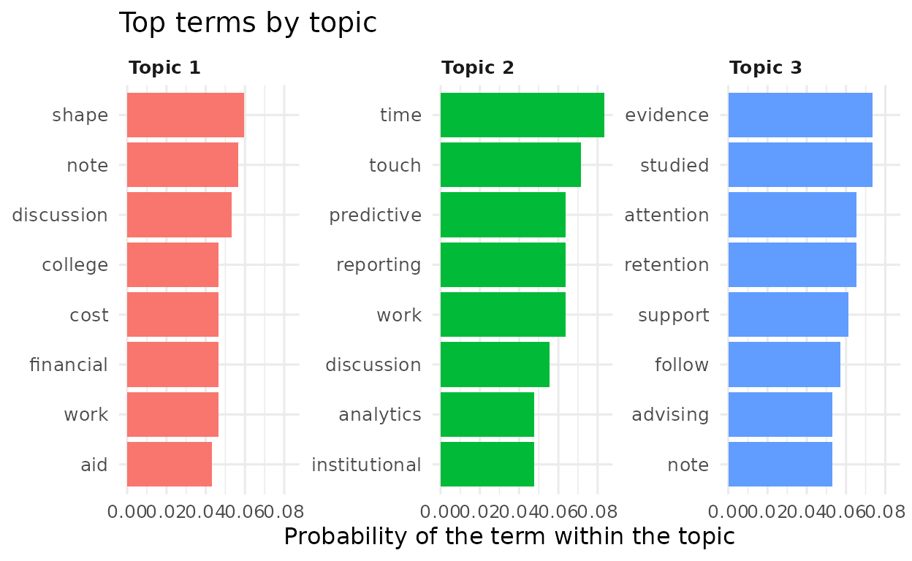
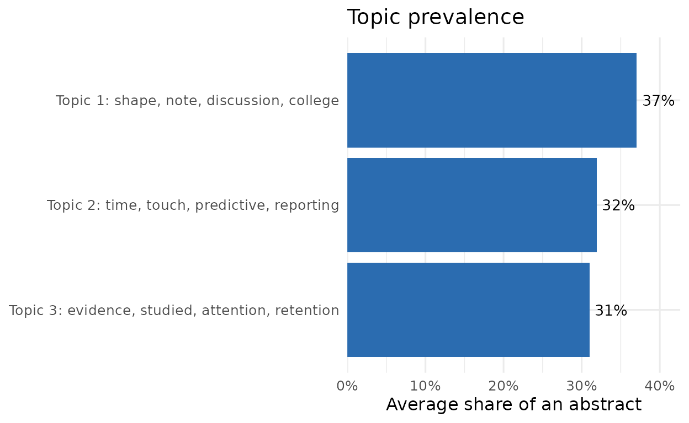
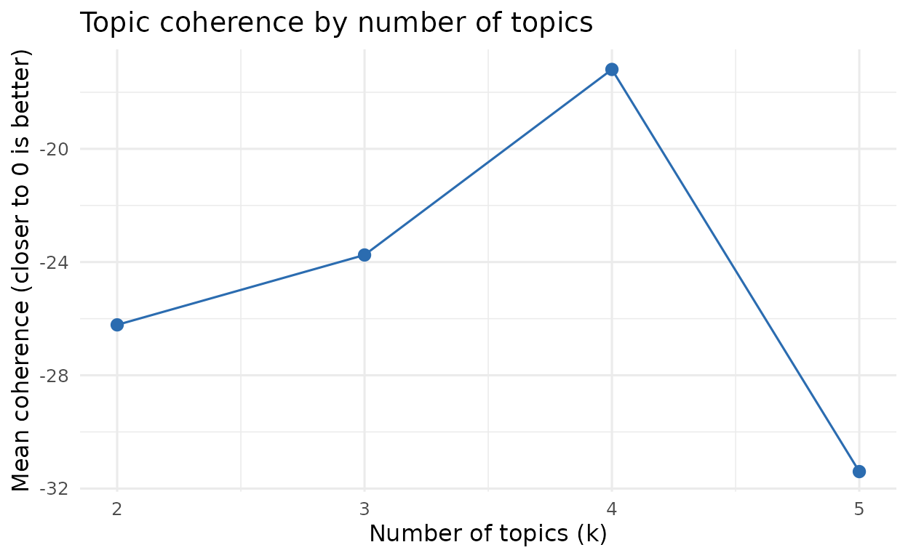
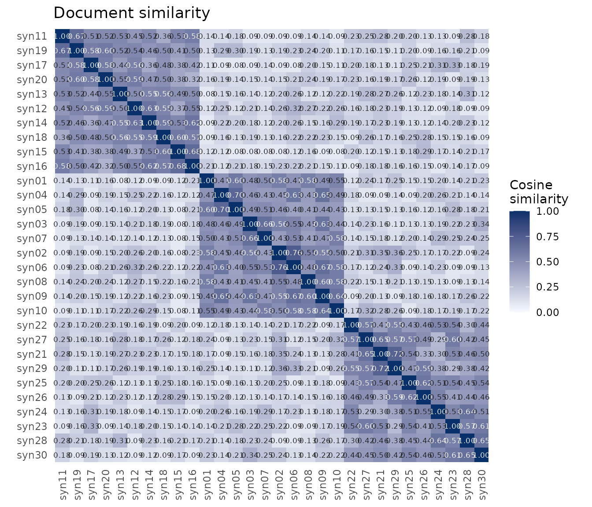
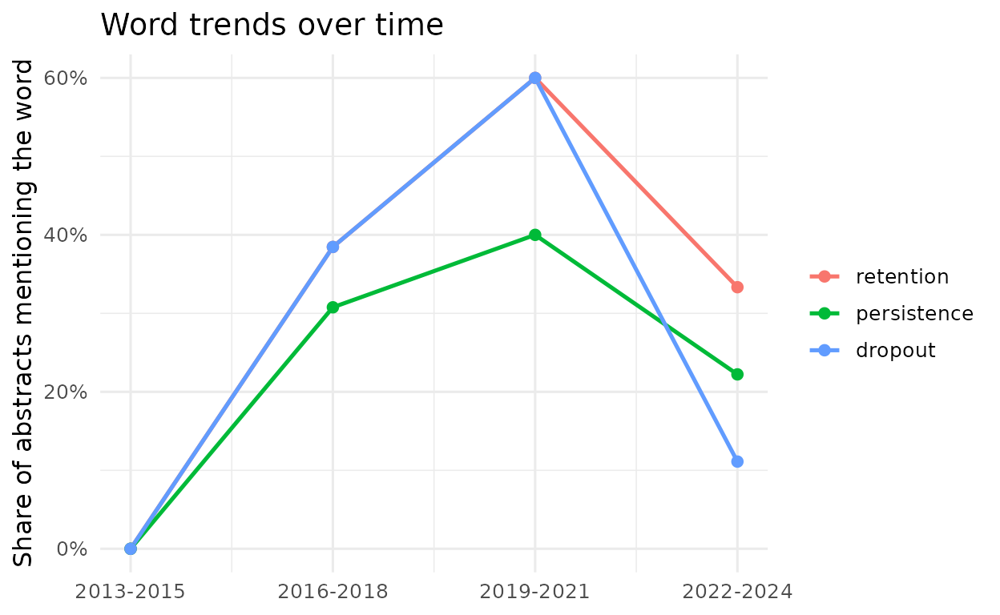
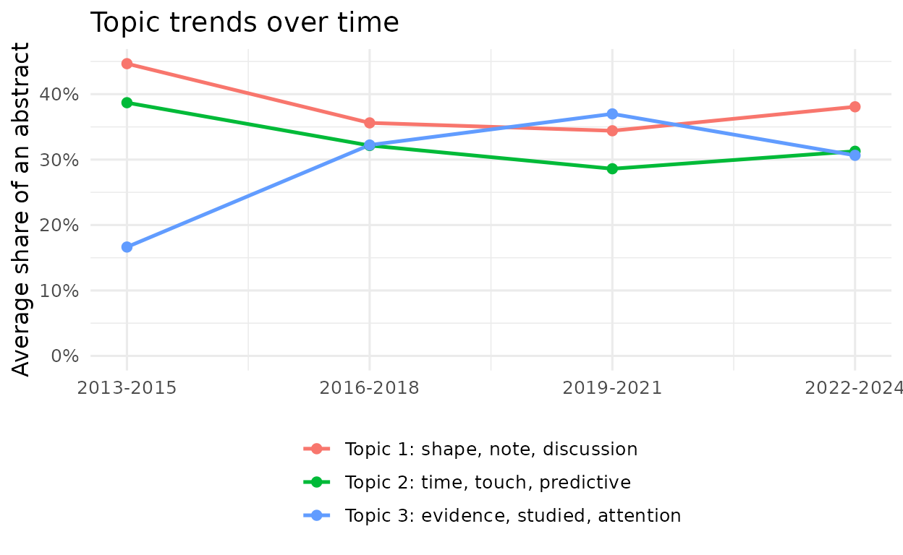

# Getting started with citelens

## Introduction

Bibliometric software often assumes that you can export records from a
subscription database such as Scopus or Web of Science. Many students,
institutional researchers, and small teams cannot. What they do have is
a reference-manager library (RefWorks, or anything that exports RIS), a
set of Google Scholar searches, or a BibTeX file collected by hand.

`citelens` is a workaround for that situation. It takes the records you
*can* get and turns them into analysis-ready data frames, then runs text
analytics on the abstracts. It does four things:

1.  **Converts** RefWorks and RIS exports, and saved Google Scholar
    results pages, to BibTeX.
2.  **Reads** BibTeX into a data frame or an Excel workbook.
3.  **Fills in** missing abstracts by looking them up in
    [OpenAlex](https://openalex.org), a free scholarly index.
4.  **Analyzes** abstracts: topic modeling (latent Dirichlet
    allocation), cosine document similarity with duplicate finding, and
    trends over time.

The parsing and the computationally heavy steps are written in C++
through `Rcpp`, so the package stays fast on large libraries.

`citelens` does not try to replace general-purpose tools. If you can
already export from a major database, or you want a full science-mapping
toolkit (co-citation networks, collaboration maps, and so on), packages
such as `bibliometrix` and `openalexR` are built for that. `citelens` is
for the earlier steps of getting a messy library into shape, and for
abstract-level text analysis that does not need a paid database.

## Installation

``` r

install.packages("citelens")
```

The C++ code is compiled when you install, so you need a C++ compiler:
the Xcode command line tools on macOS, Rtools on Windows, or
`build-essential` (or your distribution’s equivalent) on Linux.

``` r

library(citelens)
```

## Sample data

The package ships with small sample files so that every example below
can be run as is.

``` r

list.files(system.file("extdata", package = "citelens"))
#> [1] "sample_abstracts.bib" "sample_authors.csv"   "sample_refworks.ris" 
#> [4] "sample_refworks.txt"  "sample.bib"
```

- `sample_refworks.ris` and `sample_refworks.txt`: a few references in
  RIS and RefWorks Tagged Format.
- `sample.bib`: the same references as BibTeX.
- `sample_abstracts.bib`: 30 *synthetic* abstracts for trying the text
  analytics. The text is made up, so the results are for illustration
  only.

## Converting a RefWorks or RIS export

[`convert_refworks()`](https://cownr10r.github.io/citelens/reference/convert_refworks.md)
reads a RefWorks export and returns BibTeX entries. It accepts both
**RefWorks Tagged Format** (lines such as `RT`, `A1`, `T1`) and **RIS**
(lines such as `TY -`, `AU -`), and detects which one you supplied.

``` r

ris <- system.file("extdata", "sample_refworks.ris", package = "citelens")
entries <- convert_refworks(ris)
cat(entries[1])
#> @article{tinto2006research,
#>   author   = {Tinto, Vincent},
#>   title    = {{Research and practice of student retention: What next?}},
#>   journal  = {Journal of College Student Retention: Research, Theory \& Practice},
#>   year     = 2006,
#>   volume   = {8},
#>   number   = {1},
#>   pages    = {1--19},
#>   issn     = {1521-0251},
#>   doi      = {10.2190/4NWK-STAC-2PLH-PJ3D},
#>   url      = {https://example.org/tinto2006},
#>   keywords = {retention, persistence},
#>   abstract = {This article reviews the last forty years of research on student retention and argues that institutions should focus on persistence in the classroom.}
#> }
```

Citation keys are built from the first author, the year, and the first
meaningful word of the title (for example `tinto2006research`). A letter
is added when two keys would otherwise collide. Reference types are
mapped to BibTeX types (journal article to `article`, book chapter to
`incollection`, thesis to `phdthesis`, and so on); anything unrecognized
becomes `misc`.

To write a `.bib` file, give
[`convert_refworks()`](https://cownr10r.github.io/citelens/reference/convert_refworks.md)
an output path:

``` r

bib_file <- tempfile(fileext = ".bib")
convert_refworks(ris, bib_file)
#> Converted 4 record(s) -> /tmp/RtmpQ2h6QC/file1b7e5afcaf02.bib
file.exists(bib_file)
#> [1] TRUE
```

### From RefWorks straight to Excel

If a spreadsheet is what you need,
[`refworks_to_xlsx()`](https://cownr10r.github.io/citelens/reference/refworks_to_xlsx.md)
does the whole job in one step. It can also keep the BibTeX copy.

``` r

xlsx_file <- tempfile(fileext = ".xlsx")
refs <- refworks_to_xlsx(ris, xlsx_file, bib = tempfile(fileext = ".bib"))
#> Converted 4 record(s) -> /tmp/RtmpQ2h6QC/file1b7e6ba79654.bib
#> Wrote 4 entries to /tmp/RtmpQ2h6QC/file1b7e28c2942e.xlsx
file.exists(xlsx_file)
#> [1] TRUE
```

The data frame is returned invisibly, so you can keep working with it in
R.

## Reading BibTeX into a data frame

[`bib_to_df()`](https://cownr10r.github.io/citelens/reference/bib_to_df.md)
reads any BibTeX file, whether it came from
[`convert_refworks()`](https://cownr10r.github.io/citelens/reference/convert_refworks.md),
Google Scholar’s **Cite \> BibTeX** option, or another tool.

``` r

refs <- bib_to_df(system.file("extdata", "sample.bib", package = "citelens"))
refs[, c("bibtype", "bibkey", "year", "title")]
#>         bibtype     bibkey year
#> 1       article  tinto2006 2006
#> 2          book bailey2015 2015
#> 3 inproceedings nobody2020 2020
#>                                                    title
#> 1 Research and practice of student retention: What next?
#> 2               Redesigning America's Community Colleges
#> 3                      A title with a nested brace group
```

The result has one row per entry. `bibtype` and `bibkey` come first,
followed by one column for every BibTeX field found in the file. Fields
an entry does not have are `NA`, and every column is character, so
convert `year` with
[`as.integer()`](https://rdrr.io/r/base/integer.html) if you need to do
arithmetic on it.

By default the values are cleaned: grouping braces are removed
(`{{Title}}` becomes `Title`), escapes such as `\&` are undone, and
extra whitespace is collapsed. Use `clean = FALSE` for the raw values.
Files saved with Windows-1252 curly quotes or hidden control characters
are repaired as they are read, so the Excel output opens cleanly.

You can also save a workbook while reading:

``` r

refs <- bib_to_df("references.bib", xlsx = "references.xlsx")
```

## Google Scholar results

Google Scholar has no public API and blocks automated requests, so
`citelens` never contacts it. Instead, you save a results page from your
browser (**File \> Save Page As**, then “Webpage, HTML Only”) and let
the package read the saved file.

``` r

# one page
res <- scholar_parse_html("~/Downloads/scholar_page1.html")

# a whole folder: every .html file is read and combined
res <- scholar_parse_html("~/Documents/scholar_pages")

# include subfolders
res <- scholar_parse_html("~/Documents/scholar_pages", recursive = TRUE)

# straight to BibTeX; repeated results are removed
scholar_html_to_bib("~/Documents/scholar_pages", "scholar.bib")
```

Files in the folder that are not Scholar results pages are skipped with
a warning that names them. The `source_file` column shows which file
each result came from.

A results list is a summary, not a full record. It gives title, authors,
venue, year, publisher, and link, but it shortens long author lists and
venue names with “…”, and it has no volume, pages, DOI, or abstract.
Shortened entries are flagged (a `note` field in the BibTeX;
`authors_truncated` and `venue_truncated` columns in the data frame) so
you can find them. When you need complete records, use Scholar’s **Cite
\> BibTeX**, or its **RefWorks / RefMan** exports, which
[`bib_to_df()`](https://cownr10r.github.io/citelens/reference/bib_to_df.md)
and
[`convert_refworks()`](https://cownr10r.github.io/citelens/reference/convert_refworks.md)
read directly.

## Looking up missing abstracts in OpenAlex

Text analytics need abstracts, and Scholar’s results list has none.
[`fetch_abstracts()`](https://cownr10r.github.io/citelens/reference/fetch_abstracts.md)
looks them up in OpenAlex, by DOI when you have one and by title
otherwise.

OpenAlex requires a free API key:

1.  Create a free account at <https://openalex.org>.
2.  Copy your key from <https://openalex.org/settings/api>.
3.  Save it once in R. It is picked up automatically afterward.

``` r

Sys.setenv(OPENALEX_API_KEY = "your-key")   # this session only
# To keep it permanently, add OPENALEX_API_KEY=your-key to your .Renviron file.
```

The examples below send requests over the internet, so they are not run
when this vignette is built.

``` r

res <- scholar_parse_html("~/Downloads/scholar_page1.html")
res <- fetch_abstracts(res)          # or fetch_abstracts(res, api_key = "your-key")

# the same, but straight to BibTeX with abstracts included
scholar_html_to_bib("scholar_page1.html", "scholar.bib", abstracts = TRUE)
```

[`fetch_abstracts()`](https://cownr10r.github.io/citelens/reference/fetch_abstracts.md)
also works on a
[`bib_to_df()`](https://cownr10r.github.io/citelens/reference/bib_to_df.md)
table that has DOIs.

**What is sent.** Each title (or DOI) and your key are sent to OpenAlex,
and nothing else.

**Being careful about matches.** A title match is accepted only when the
titles are very close *and* the publication years agree to within a
year. Otherwise the abstract stays `NA`, because a missing abstract is
better than the wrong one. Many works in OpenAlex have no abstract on
file, so expect gaps.

**Diagnosing gaps.** The `abstract_status` column says what happened to
each reference:

``` r

table(res$abstract_status)

# titles that did not match, with the closest candidate found
res[res$abstract_status == "title not matched",
    c("title", "closest_title", "closest_score")]

# if the closest titles are the right papers, accept looser matches
res <- fetch_abstracts(res, min_match = 0.75)

# "year differs": the title matched but the years are far apart
# (re-editions, online-first dates)
res[res$abstract_status == "year differs", c("title", "year", "closest_year")]
res <- fetch_abstracts(res, max_year_diff = 10)
```

The statuses are `found`, `no abstract on file`, `title not matched`,
`year differs`, `no results`, and `lookup failed`. Only the
still-missing references are retried when you run the function again on
its own result. The columns `abstract_match` and `abstract_source` help
you spot-check what was found.

**Usage limits.** A free key currently allows a daily allowance of
credits, and a title lookup costs more than a DOI lookup, so a few
thousand references fit in a day. If the allowance runs out, the
function stops and keeps what it found. Run it again later on the same
object and it picks up where it left off.

## Topic modeling

The text analytics all work on a data frame with an `abstract` column,
such as the output of
[`bib_to_df()`](https://cownr10r.github.io/citelens/reference/bib_to_df.md).
If your column has a different name, pass it with `text = "..."`.

``` r

refs <- bib_to_df(system.file("extdata", "sample_abstracts.bib",
                              package = "citelens"))
nrow(refs)
#> [1] 30
```

[`topic_model()`](https://cownr10r.github.io/citelens/reference/topic_model.md)
fits a latent Dirichlet allocation model to the abstracts. Set a `seed`
so the result is reproducible.

``` r

m <- topic_model(refs, k = 3, seed = 1)
m
#> <citelens topic model>
#> 3 topics from 30 abstracts (61 distinct words, 796 word occurrences)
#> alpha = 1.67, beta = 0.01, sweeps = 1000
#> 
#>  topic prevalence n_docs coherence
#>      1        37%     10     -22.5
#>      2        32%     10     -25.0
#>      3        31%     10     -23.7
#>                                                 top_terms
#>         shape, note, discussion, college, cost, financial
#>      time, touch, predictive, reporting, work, discussion
#>  evidence, studied, attention, retention, support, follow
```

Printing the model gives each topic’s prevalence, a coherence score, and
its top words. The helpers return the same information as data frames:

``` r

topic_terms(m, n = 5)      # top words per topic
#>    topic rank       term       beta
#> 1      1    1      shape 0.05971287
#> 2      1    2       note 0.05639733
#> 3      1    3 discussion 0.05308179
#> 4      1    4    college 0.04645071
#> 5      1    5       cost 0.04645071
#> 6      2    1       time 0.08350225
#> 7      2    2      touch 0.07157903
#> 8      2    3 predictive 0.06363022
#> 9      2    4  reporting 0.06363022
#> 10     2    5       work 0.06363022
#> 11     3    1   evidence 0.07362741
#> 12     3    2    studied 0.07362741
#> 13     3    3  attention 0.06545113
#> 14     3    4  retention 0.06545113
#> 15     3    5    support 0.06136299
topic_summary(m)           # one row per topic
#>   topic prevalence n_docs coherence
#> 1     1  0.3705550     10 -22.48675
#> 2     2  0.3195286     10 -25.02995
#> 3     3  0.3099164     10 -23.73066
#>                                          top_terms
#> 1           shape, note, discussion, college, cost
#> 2         time, touch, predictive, reporting, work
#> 3 evidence, studied, attention, retention, support
```

[`topic_documents()`](https://cownr10r.github.io/citelens/reference/topic_documents.md)
adds each abstract’s dominant topic to your table, along with the
probability of that topic and the full topic mixture:

``` r

refs2 <- topic_documents(m, refs)
head(refs2[, c("title", "dominant_topic", "dominant_prob")])
#>                               title dominant_topic dominant_prob
#> 1 Advising and first-year retention              3     0.6666667
#> 2    Predicting student persistence              3     0.6565657
#> 3 Advising and first-year retention              3     0.6021505
#> 4    Predicting student persistence              3     0.5376344
#> 5 Advising and first-year retention              3     0.5698925
#> 6 Advising and first-year retention              3     0.6262626
```

Two charts summarize a model:

``` r

plot_topic_terms(m)
```



``` r

plot_topic_prevalence(m)
```



### Choosing the number of topics

There is no single correct `k`.
[`topic_k_search()`](https://cownr10r.github.io/citelens/reference/topic_k_search.md)
fits models for a range of values so you can compare them, and
[`plot()`](https://rdrr.io/r/graphics/plot.default.html) draws the
comparison.

``` r

ks <- topic_k_search(refs, k = 2:5, seed = 1)
plot(ks)
```



Treat this as a guide and read the topics themselves. A `k` whose topics
you can name and defend is usually better than one that wins on a
statistic.

### Tips

- Topic models work best with dozens of abstracts or more. The functions
  warn when you supply very few.
- Words that carry no meaning in your field can be dropped with
  `stopwords = c("student", "college")`. The built-in list is available
  from
  [`citelens_stopwords()`](https://cownr10r.github.io/citelens/reference/citelens_stopwords.md).
- `max_doc_prop = 0.5` drops words found in more than half the
  abstracts.
- Before modeling, words are lower-cased, punctuation and numbers are
  removed, common English words and abstract boilerplate (“study”,
  “results”, and so on) are dropped, and simple plurals are merged
  (“student” and “students” count as one).

## Document similarity

[`doc_similarity()`](https://cownr10r.github.io/citelens/reference/doc_similarity.md)
compares every pair of abstracts using cosine similarity of TF-IDF word
weights.

``` r

s <- doc_similarity(refs)
s
#> <citelens document similarity>
#> 30 abstracts, 61 distinct words
#> pairwise cosine similarity: median 0.207, 90th percentile 0.553, max 0.761
#> Use similarity_to_df(s) for a table (and xlsx = "file.xlsx" to save it to Excel).
```

Find the closest matches to one paper, or look for likely duplicate
entries:

``` r

similar_to(s, "syn01", n = 3, data = refs)
#>   rank    id similarity                                title
#> 1    1 syn05  0.6022649    Advising and first-year retention
#> 2    2 syn08  0.5754191 Reducing attrition through mentoring
#> 3    3 syn02  0.5753822       Predicting student persistence
find_duplicates(s, cutoff = 0.8, data = refs)
#> [1] id_1       id_2       similarity title_1    title_2   
#> <0 rows> (or 0-length row.names)
```

[`plot_similarity()`](https://cownr10r.github.io/citelens/reference/plot_similarity.md)
draws a heatmap with similar abstracts grouped together:

``` r

plot_similarity(s)
```



To work with the numbers,
[`similarity_to_df()`](https://cownr10r.github.io/citelens/reference/similarity_to_df.md)
returns them as a data frame, in either a matrix layout (one row and
column per reference) or a pairs layout (one row per pair, most similar
first):

``` r

head(similarity_to_df(s, "pairs", data = refs), 5)
#>    id_1  id_2 similarity                               title_1
#> 1 syn02 syn06      0.761        Predicting student persistence
#> 2 syn21 syn29      0.724 Assessment and accountability metrics
#> 3 syn04 syn05      0.702        Predicting student persistence
#> 4 syn15 syn16      0.678      Tuition and enrollment decisions
#> 5 syn11 syn19      0.673         Scholarships and student debt
#>                                 title_2
#> 1     Advising and first-year retention
#> 2 Predictive models in higher education
#> 3     Advising and first-year retention
#> 4       Financial aid and affordability
#> 5      Tuition and enrollment decisions
```

Add `xlsx = "similarity.xlsx"` to also save an Excel workbook with both
layouts, and `cutoff = 0.5` to keep only pairs at or above that
similarity.

Similarity reflects shared vocabulary, not shared meaning. Two abstracts
on different subjects can look alike if they use the same technical
language, so use `stopwords =` to remove words common to your whole
collection.

## Trends over time

The trend functions need a `year` column.
[`word_trends()`](https://cownr10r.github.io/citelens/reference/word_trends.md)
shows the share of abstracts mentioning each word, by year or by group
of years:

``` r

w <- word_trends(refs, words = c("retention", "persistence", "dropout"),
                 bin = 3)
w
#>    period        term n_docs n_period     share
#> 1    2013   retention      0        3 0.0000000
#> 2    2016   retention      5       13 0.3846154
#> 3    2019   retention      3        5 0.6000000
#> 4    2022   retention      3        9 0.3333333
#> 5    2013 persistence      0        3 0.0000000
#> 6    2016 persistence      4       13 0.3076923
#> 7    2019 persistence      2        5 0.4000000
#> 8    2022 persistence      2        9 0.2222222
#> 9    2013     dropout      0        3 0.0000000
#> 10   2016     dropout      5       13 0.3846154
#> 11   2019     dropout      3        5 0.6000000
#> 12   2022     dropout      1        9 0.1111111
plot_word_trends(w)
```



`bin` groups years; `bin = 3` uses three-year periods. If you leave
`words` as `NULL`, the most common words are used.

[`topic_trends()`](https://cownr10r.github.io/citelens/reference/topic_trends.md)
does the same for topics, using a fitted model:

``` r

tt <- topic_trends(m, refs, bin = 3)
plot_topic_trends(tt)
```



Check `n_period`, the number of abstracts in each period. Periods with
only a few abstracts give jumpy shares, so avoid reading much into them.

## Using the results with other tools

Because `citelens` produces ordinary BibTeX files, data frames, and
Excel workbooks, you can hand its output to other tools.

- The `.bib` file opens in any reference manager that reads BibTeX.
- The data frames work with the usual R tools (`dplyr`, `ggplot2`, and
  others).
- The Excel files can be opened in Excel or imported by other software.

Packages that expect records in a specific database layout, such as the
field names used by Scopus or Web of Science, may need extra renaming of
columns before they accept the data. Check the documentation of the tool
you plan to use.

## Good to know

- The text analytics skip references with no abstract and tell you how
  many were skipped.
- All data frame columns are character, including `year`.
- Accent commands such as `{\'e}` are left as LaTeX when reading BibTeX.
- BibTeX features supported when reading include `@string` macros, month
  names, `#` concatenation, and `{...}`, `"..."`, and `(...)`
  delimiters. `@comment` and `@preamble` blocks are ignored.
- Topic modeling and similarity describe the *text* of abstracts. They
  are exploratory tools, not substitutes for reading the papers.

``` r

sessionInfo()
#> R version 4.6.2 (2026-10-29)
#> Platform: x86_64-pc-linux-gnu
#> Running under: Ubuntu 26.04.1 LTS
#> 
#> Matrix products: default
#> BLAS:   /usr/lib/x86_64-linux-gnu/openblas-pthread/libblas.so.3 
#> LAPACK: /usr/lib/x86_64-linux-gnu/openblas-pthread/libopenblasp-r0.3.32.so;  LAPACK version 3.12.0
#> 
#> locale:
#>  [1] LC_CTYPE=C.UTF-8       LC_NUMERIC=C           LC_TIME=C.UTF-8       
#>  [4] LC_COLLATE=C.UTF-8     LC_MONETARY=C.UTF-8    LC_MESSAGES=C.UTF-8   
#>  [7] LC_PAPER=C.UTF-8       LC_NAME=C              LC_ADDRESS=C          
#> [10] LC_TELEPHONE=C         LC_MEASUREMENT=C.UTF-8 LC_IDENTIFICATION=C   
#> 
#> time zone: UTC
#> tzcode source: system (glibc)
#> 
#> attached base packages:
#> [1] stats     graphics  grDevices utils     datasets  methods   base     
#> 
#> other attached packages:
#> [1] citelens_0.2.0
#> 
#> loaded via a namespace (and not attached):
#>  [1] vctrs_0.7.3        cli_3.6.6          knitr_1.52         rlang_1.3.0       
#>  [5] xfun_0.62          otel_0.3.0         S7_1.0.0           textshaping_1.1.0 
#>  [9] jsonlite_2.0.0     labeling_0.4.3     glue_1.8.1         htmltools_0.5.9   
#> [13] ragg_1.5.2         sass_0.5.0         writexl_2.0.1      scales_1.4.0      
#> [17] rmarkdown_2.32     grid_4.6.2         evaluate_1.0.5     jquerylib_0.1.4   
#> [21] fastmap_1.2.0      yaml_2.3.12        lifecycle_1.0.5    compiler_4.6.2    
#> [25] RColorBrewer_1.1-3 fs_2.1.0           Rcpp_1.1.2         farver_2.1.2      
#> [29] systemfonts_1.3.3  digest_0.6.39      R6_2.6.1           bslib_0.12.0      
#> [33] withr_3.0.3        gtable_0.3.6       tools_4.6.2        pkgdown_2.2.1     
#> [37] ggplot2_4.0.4      cachem_1.1.0       desc_1.4.3
```
